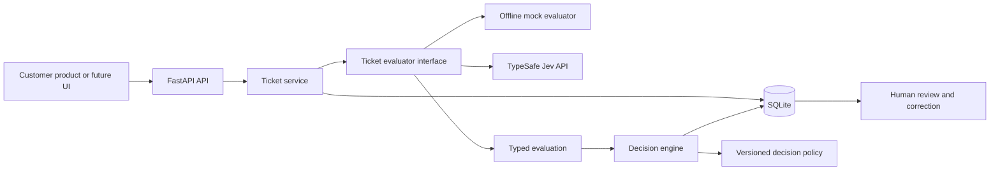

# AI-Powered Customer Support Triage & Resolution API


A confidence-gated support ticket triage backend built with FastAPI, TypeSafe Jev, and SQLite. It classifies incoming tickets, assigns queues and priorities, flags uncertain decisions for human review, preserves the complete decision history, and exposes an API that other products can integrate with.

> **Project status:** Backend Phase 3 is complete. The application currently defaults to an offline mock evaluator. The live Jev request contract and error handling are tested with simulated HTTP responses, but the integration has not yet been exercised with a real TypeSafe API key. The customer and support-agent UI is deliberately planned for the final phase.

## Why this project exists

A useful support system needs more than a category predicted by an AI model. It also needs to:

- preserve every customer ticket when the AI provider is unavailable;
- distinguish a confident result from an uncertain one;
- keep business rules in application code;
- provide a human-review path for risky or ambiguous decisions;
- retain the original AI evidence after a person corrects it;
- expose a stable API that other teams can call or self-host.

Jev makes narrow, typed judgments. This project turns those judgments into an auditable support workflow.

## Current features

- Async FastAPI API with generated OpenAPI and Swagger documentation
- Offline mock mode that works without an API key
- Live TypeSafe System One HTTP client
- Four judgments in one Jev request:
  - ticket category using **Choice**;
  - urgency using **Score**;
  - customer sentiment using **Score**;
  - immediate escalation need using **Noul**
- Confidence-gated routing with explicit human-review paths
- P1–P4 priority assignment and escalation rules
- SQLite persistence with SQLAlchemy's async API
- Ticket, evaluation, decision, and human-review history
- Ticket lifecycle: open, in progress, resolved, and reopened
- Retryable triage when the AI provider is unavailable
- Filtered and paginated support work queue
- Stable error envelopes for API consumers
- Automated unit, integration, database, and API tests

## Architecture



The main layers are intentionally separate:

| Layer | Responsibility |
|---|---|
| `app/api` | HTTP routes, dependencies, request validation, and response models |
| `app/services` | Jev communication and ticket workflow orchestration |
| `app/decision` | Pure confidence calculations, thresholds, and routing rules |
| `app/db` | SQLAlchemy models, sessions, and queries |
| `app/schemas` | Typed API and provider-boundary contracts |

The decision engine has no FastAPI, database, or network dependency. Other Python applications can reuse it directly, while applications written in any language can use the HTTP API.

## Ticket processing flow

For a persisted ticket, the application follows this sequence:

1. Validate the subject and message.
2. Save the customer ticket before making an external request.
3. Ask the evaluator four independent questions.
4. Compute confidence from the returned probability distributions.
5. Apply the versioned decision policy.
6. Store the raw evaluation and application decision separately.
7. Return the current queue, priority, escalation status, reasons, and evidence.
8. Allow a support agent to confirm or correct the decision later.

Saving first prevents a provider outage from losing the customer's request. The application also avoids holding a SQLite write lock while waiting for the network.

## Technology

- Python 3.12
- FastAPI
- Uvicorn
- HTTPX
- Pydantic and Pydantic Settings
- SQLAlchemy async API
- aiosqlite
- pytest and pytest-asyncio
- TypeSafe Jev System One API

## Project structure

```text
.
├── app/
│   ├── api/
│   │   ├── deps.py
│   │   ├── routes.py          # Stateless triage and policy endpoints
│   │   └── tickets.py         # Persistent ticket workflow endpoints
│   ├── core/
│   │   └── config.py
│   ├── db/
│   │   ├── models.py
│   │   ├── repository.py
│   │   └── session.py
│   ├── decision/
│   │   ├── confidence.py
│   │   ├── engine.py
│   │   └── policy.py
│   ├── schemas/
│   ├── services/
│   │   ├── jev.py
│   │   ├── mock_jev.py
│   │   ├── rubric.py
│   │   └── ticket_service.py
│   └── main.py
├── scripts/
│   └── smoke_test.py
├── tests/
├── .env.example
├── pytest.ini
└── requirements.txt
```

## Quick start on Windows

### 1. Create and activate a virtual environment

```powershell
python -m venv .venv
.\.venv\Scripts\Activate.ps1
```

If PowerShell prevents activation, you can run the virtual environment's Python executable directly in every command instead.

### 2. Install dependencies

```powershell
python -m pip install --upgrade pip
python -m pip install -r requirements.txt
```

### 3. Create local configuration

```powershell
Copy-Item .env.example .env
```

The example configuration uses offline mock mode, so no external account or key is required:

```dotenv
JEV_MODE=mock
TYPESAFE_API_KEY=
JEV_MODEL=jev-1.14.0
JEV_API_URL=https://api.typesafe.ai/v1/systemone
JEV_TIMEOUT_SECONDS=15
DATABASE_URL=sqlite:///./triage.db
```

### 4. Start the API

```powershell
python -m uvicorn app.main:app --reload --port 8766
```

Open:

- Swagger UI: <http://127.0.0.1:8766/docs>
- OpenAPI schema: <http://127.0.0.1:8766/openapi.json>
- Health endpoint: <http://127.0.0.1:8766/health>

The SQLite tables are created at startup. The generated `triage.db` file is ignored by Git.

## Submit a persisted ticket

### Request

```http
POST /api/v1/tickets
Content-Type: application/json
```

```json
{
  "subject": "Production payment outage",
  "message": "Every transaction is failing and we are losing sales. We need help immediately."
}
```

PowerShell example:

```powershell
$body = @{
    subject = "Production payment outage"
    message = "Every transaction is failing and we are losing sales. We need help immediately."
} | ConvertTo-Json

Invoke-RestMethod `
    -Method Post `
    -Uri "http://127.0.0.1:8766/api/v1/tickets" `
    -ContentType "application/json" `
    -Body $body
```

### Abridged response

```json
{
  "id": 1,
  "subject": "Production payment outage",
  "status": "open",
  "triage_state": "triaged",
  "queue": "technical_support",
  "priority": "P1",
  "escalated": true,
  "needs_review": false,
  "decision": {
    "queue": "technical_support",
    "priority": "P1",
    "escalate": true,
    "handling": "auto_route",
    "reasons": [
      {
        "code": "escalated",
        "detail": "Escalation probability reached the configured threshold."
      }
    ],
    "policy_version": "2026-11-18.1"
  },
  "evaluation": {
    "model": "mock"
  },
  "reviews": []
}
```

The complete response includes timestamps, confidence signals, probability distributions, rubric legends, and usage information. See Swagger for the exact schema.

## API endpoints

| Method | Endpoint | Description |
|---|---|---|
| `GET` | `/health` | Report application and evaluator status |
| `POST` | `/api/v1/triage` | Evaluate and decide without storing a ticket |
| `GET` | `/api/v1/policy` | Show the active decision thresholds and queue map |
| `POST` | `/api/v1/tickets` | Store and triage a new ticket |
| `GET` | `/api/v1/tickets` | List tickets in work-queue order |
| `GET` | `/api/v1/tickets/{ticket_id}` | Return a ticket with its latest AI evidence and full review history |
| `POST` | `/api/v1/tickets/{ticket_id}/triage` | Retry a pending or failed triage operation |
| `POST` | `/api/v1/tickets/{ticket_id}/review` | Confirm or correct an AI decision |
| `PATCH` | `/api/v1/tickets/{ticket_id}/status` | Start, resolve, or reopen a ticket |

### List filters

`GET /api/v1/tickets` supports:

- `status=open|in_progress|resolved`
- `queue=<queue-name>`
- `priority=P1|P2|P3|P4`
- `needs_review=true|false`
- `triage_state=pending|triaged|failed`
- `limit=1..200`
- `offset=0..n`

Tickets are ordered by priority, then age. Tickets without a priority appear last.

## Human review

Confirm the AI decision by sending only a reviewer:

```json
{
  "reviewer": "dana"
}
```

Correct one or more fields by including replacements:

```json
{
  "reviewer": "dana",
  "queue": "billing",
  "priority": "P2",
  "escalate": false,
  "note": "The customer is reporting an invoice problem."
}
```

The corrected values become the ticket's current work-queue values. The original AI decision remains unchanged. This creates an audit trail and labelled examples for later confidence calibration.

## Failure and retry behavior

If Jev times out, is rate-limited, or is overloaded, the ticket remains stored:

```json
{
  "triage_state": "failed",
  "triage_error": "Jev is rate limiting or overloaded",
  "decision": null,
  "evaluation": null
}
```

Retry it after the provider recovers:

```http
POST /api/v1/tickets/{ticket_id}/triage
```

Provider HTTP `429` and `529`, timeouts, and transport errors are treated as temporarily unavailable. Automatic bounded retries are planned for a later phase.

## Decision policy

The policy is defined in `app/decision/policy.py` and exposed through `GET /api/v1/policy`.

| Signal | Current starting rule |
|---|---|
| Category confidence `< 0.30` | Do not guess; send to `triage_desk` for human triage |
| Category confidence `0.30–<0.60` | Route tentatively and request review |
| Category confidence `>= 0.60` | Route automatically |
| Urgency score `>= 2.50` | P1 |
| Urgency score `>= 1.50` | P2 |
| Urgency score `>= 0.75` | P3 |
| Lower urgency score | P4 |
| Low urgency confidence | Request review and prevent a P4 result |
| Confident hostile sentiment | Raise priority by one level |
| Escalation probability `0.40–<0.80` | Request human review |
| Escalation probability `>= 0.80` | Escalate and assign P1 |

These thresholds are conservative starting values, not calibrated production settings. Confidence measures how concentrated a probability distribution is; it does not prove that an answer is correct. Thresholds must be evaluated against labelled tickets for the selected model version and rubric.

## Choice, Score, and Noul

- **Choice** selects one option and returns a probability distribution across all options.
- **Score** evaluates ordered, independently described levels and returns a probability-weighted score that may fall between levels.
- **Noul** returns the probability that a yes/no statement is true. A value near `0.5` means the evidence is ambiguous, not that the condition is medium-strength.

The application asks all four questions in one request and keeps workflow control in ordinary Python code.

## Use the real Jev API

Create a key in the [TypeSafe console](https://console.typesafe.ai/keys), then update `.env`:

```dotenv
JEV_MODE=live
TYPESAFE_API_KEY=your_private_key
JEV_MODEL=jev-1.14.0
```

Restart the API after changing the environment.

The key stays server-side and is represented as a Pydantic `SecretStr` to reduce accidental disclosure. Never put it in frontend JavaScript, commit `.env`, or return it in API errors.

The model is pinned instead of using a moving alias. Model changes can shift probability distributions and invalidate previously chosen thresholds.

## Integrating from another product

### Hosted API

A product written in any language can send a JSON request to `POST /api/v1/triage` for stateless evaluation or `POST /api/v1/tickets` for the persisted workflow.

Python example:

```python
import httpx

async def submit_ticket(subject: str, message: str) -> dict:
    async with httpx.AsyncClient(base_url="http://127.0.0.1:8766") as client:
        response = await client.post(
            "/api/v1/tickets",
            json={"subject": subject, "message": message},
        )
        response.raise_for_status()
        return response.json()
```

The current development API does **not** authenticate client applications. Do not expose it directly to the public internet yet. API keys, quotas, and rate limiting are planned before deployment.

### Self-hosted backend

Developers can clone the repository, supply their own TypeSafe key, configure their own SQLite path, and run the FastAPI service themselves. The decision engine and policy can also be imported directly by Python projects.

## Testing

Run the full test suite:

```powershell
python -m pytest -q
```

At the end of Phase 3, the suite contains 77 passing tests covering:

- exact confidence formulas;
- decision thresholds and boundary values;
- uncertain and conflicting signals;
- Jev request construction and response parsing;
- provider error mapping;
- input validation;
- ticket persistence across database restarts;
- SQLite foreign-key enforcement;
- AI outage recovery and triage retry;
- work-queue ordering, filtering, and pagination;
- human confirmation and correction;
- ticket status transitions.

Run the end-to-end smoke test while the API is running:

```powershell
python scripts\smoke_test.py
```

The smoke test intentionally creates three demonstration tickets in the configured database, then reviews one and resolves another.

## Security and production notes

Implemented now:

- secrets loaded from environment variables;
- masked API-key representation;
- input length limits;
- generic provider errors that do not expose credentials or ticket text;
- server-side provider calls only;
- SQLite foreign-key enforcement and busy timeout;
- immutable evaluation and decision history.

Still required before public deployment:

- client authentication and authorization;
- per-client rate limits and quotas;
- structured logs and request correlation IDs;
- CORS rules for the future frontend;
- database migrations with Alembic;
- privacy and retention rules for customer ticket content;
- deployment configuration, HTTPS, backups, and monitoring.

When `JEV_MODE=live`, ticket subject and message content are sent to TypeSafe for evaluation. Review the provider's current privacy and data-processing terms before using real customer data.

## Roadmap

- [x] Phase 1: FastAPI setup, typed Jev client, mock evaluator, and error boundary
- [x] Phase 2: confidence formulas, versioned policy, routing, priority, and escalation engine
- [x] Phase 3: SQLite persistence, work queue, review history, corrections, and status lifecycle
- [ ] Phase 4: bounded retries, authentication, rate limiting, structured logging, and calibration tooling
- [ ] Deployment: Docker, migrations, production configuration, and hosted API documentation
- [ ] Final phase: customer ticket form and support-agent dashboard

## Technical references

- [TypeSafe documentation](https://docs.typesafe.ai/)
- [TypeSafe console and API keys](https://console.typesafe.ai/keys)
- [Community-maintained TypeSafe developer guide](https://github.com/typesafe-docs/typesafeai), which links back to the official documentation and includes verified System One examples
- [FastAPI documentation](https://fastapi.tiangolo.com/)
- [SQLAlchemy asyncio documentation](https://docs.sqlalchemy.org/en/21/orm/extensions/asyncio.html)

Descriptions of Jev primitives and confidence behavior were rephrased for compliance with licensing restrictions.
